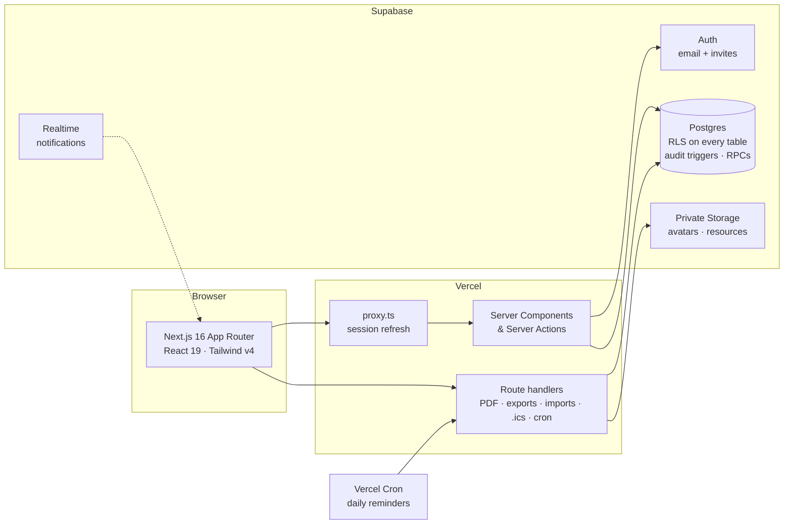

<div align="center">

# 🎓 Mentora

### Smart Mentor–Mentee Management for a Whole Engineering College

<br>

<p>
  <a href="https://mentora-zeta-six.vercel.app/"></a>
  <a href="https://mentora-zeta-six.vercel.app/signup"></a>
</p>

<p>
  
  
  
  
</p>

<p>
  
  
  
  
  
  
</p>

<p>
  <a href="#-why-mentora"><b>Why</b></a> ·
  <a href="#-one-site-for-the-whole-college"><b>Multi-branch</b></a> ·
  <a href="#-screenshots"><b>Screenshots</b></a> ·
  <a href="#-try-it"><b>Try it</b></a> ·
  <a href="#%EF%B8%8F-architecture"><b>Architecture</b></a> ·
  <a href="#-technology-stack"><b>Stack</b></a> ·
  <a href="#-quick-start"><b>Quick Start</b></a> ·
  <a href="#%EF%B8%8F-security-model"><b>Security</b></a> ·
  <a href="#-testing"><b>Testing</b></a> ·
  <a href="#-documentation"><b>Docs</b></a>
</p>

</div>

<br>

<div align="center">
  <a href="https://mentora-zeta-six.vercel.app/">
    
  </a>
</div>

<br>

Mentora gives a whole engineering college one place for mentoring, organised by **branch** (CSE, ISE, ECE, …). **Students** keep their semester records — subjects, mid-semester and semester-end marks, grades — and see their SGPA, CGPA and progress. **Mentors** verify those records, set goals with concrete steps, schedule sessions and share study material with the students assigned to them. Each **HOD** runs their own branch: coverage, mentor workload, who needs help, assignments, users and branch settings. The **Principal** sees every branch side by side, appoints HODs and approves branch transfers — read-only on student records.

**Every number is computed from verified data, and every flag explains itself.** If an SGPA can't be calculated yet, Mentora says why instead of guessing. Risk indicators name the rule and the marks behind them. Students never see other students' data or rankings.

> **The live app requires an account.** Students can [sign up free](https://mentora-zeta-six.vercel.app/signup) with their **USN email** (e.g. `nnm23cs001@…`) and become students in the branch named by their USN. Mentor, HOD and Principal accounts are created by invitation, so no one can grant themselves elevated access.

<br>

## 🎯 Why Mentora?

<table>
<tr>
<td width="50%" valign="top">

**📊 Verified Academic Records**
Semester-wise marks with a configurable 10-point grading engine. Students submit, mentors verify, records lock; corrections go through an audited request.

**⌨️ Spreadsheet-Fast Marks Entry**
Subjects auto-filled from the branch catalogue. Tab / Enter navigation, paste a block straight from Excel or Sheets, per-row autosave.

**🎯 Goals With Real Steps**
Mentors set goals and action points with checklists and due dates; students tick steps, reflect and update status — with Undo.

**🚨 Explained Risk Flags**
Declining SGPA, failed subjects, repeated low marks, incomplete profiles — each with its reason and the evidence. Thresholds are the HOD's to tune.

</td>
<td width="50%" valign="top">

**👥 Branch Control (HOD)**
Drag-and-drop mentor assignments with undo and history, capacity-aware workload, bulk invites, CSV/XLSX imports with row-level validation — all limited to the HOD's own branch.

**🏫 College Oversight (Principal)**
College coverage and branch health, students grouped by branch, branch comparisons, HOD appointments with history and branch transfers. Branches are compared; students are never ranked.

**📅 Sessions & Resources**
Schedule one-to-one or group sessions (calendar `.ics` included), record summaries, share files and links through private, short-lived download links.

**📄 Official PDF Reports**
Print-ready reports built only from verified records and mentor-approved notes. Never charts, insights, risk flags or AI text.

**🔐 Database-Enforced Access**
Row-Level Security on every table: a mentor sees only their active mentees, a student only themselves. Every sensitive change is audited.

</td>
</tr>
</table>

<br>

## 🏫 One site for the whole college

Mentora runs a whole college: every student, mentor, subject and record belongs to exactly one **branch**, and the database enforces who sees what.

| Role | Sees | Can change |
|---|---|---|
| **Student** | Only their own records and shared feedback | Their profile, drafts, goal steps |
| **Mentor** | Only students actively assigned to them (same branch) | Verifications, recommendations, sessions, resources |
| **HOD** | Only the branch they currently head | Assignments, users (students/mentors), sections, subjects, branch grading override when allowed |
| **Principal** | Every branch, read-only on student data — never private mentor notes | Branches, HOD appointments, branch transfers, college settings, imports/exports |

- **Sign-up by USN** — `nnm23cs001@…` → branch code `cs` → CSE. Non-USN emails and unknown branch codes are refused with a clear message; the Principal can require the college email domain or turn sign-up off.
- **Branches** — create, rename, reorder, archive (only when empty). Configured in `config/branches.json` (`code`, `name`, `usn_code`).
- **HOD appointments** — one active HOD per branch, with history. When an appointment ends, access ends on the next request ("Your HOD access has ended"). A branch can be temporarily without an HOD; suspended heads are flagged.
- **Branch transfers** — an HOD requests, the Principal approves (or moves a student directly). The student's records move with them, their mentor assignment ends, and everyone involved is notified.
- **Branch switcher** — the Principal narrows any page to one branch (a sheet on phones); HODs see a fixed branch chip.
- **Grading** — one college-default grading scheme and risk rules; HODs may override for their branch only when the Principal allows it. Finalized history is never recalculated.
- **Out of scope = not found** — opening another branch's student, PDF or file returns 404, and searches, counts and exports only ever include your scope.

<table>
<tr>
<td width="50%" valign="top">

**🏫 Principal — College overview**


</td>
<td width="50%" valign="top">

**📚 Principal — Students by branch**


</td>
</tr>
<tr>
<td width="50%" valign="top">

**👑 Principal — Heads of department**


</td>
<td width="50%" valign="top">

**🧭 HOD — Branch overview**


</td>
</tr>
</table>

Verification details — scoping matrix, attack tests, revocation, college-size performance — are in [E2E_REPORT.md](E2E_REPORT.md).

<br>

## 📸 Screenshots

<table>
<tr>
<td width="50%" valign="top">

**🏠 Landing**

<a href="https://mentora-zeta-six.vercel.app/"></a>

What Mentora is, at a glance — with a path straight to sign-in or student sign-up.

</td>
<td width="50%" valign="top">

**🎓 Student sign-up**

<a href="https://mentora-zeta-six.vercel.app/signup"></a>

Free for students, with live password rules. The account is created as a student by the database itself — the role is never taken from the form.

</td>
</tr>
<tr>
<td width="50%" valign="top">

**📈 Student dashboard**


Credits, goals and subjects in one banner; an SGPA trend with values per semester; CGPA with personal best; a single **Next step** chosen from your own data; mentor feedback and upcoming sessions.

</td>
<td width="50%" valign="top">

**📚 Academic records**


Every semester with its status — Draft, Submitted, Verified — and the reason whenever an SGPA can't be calculated yet. Verified semesters are locked.

</td>
</tr>
<tr>
<td width="50%" valign="top">

**🎯 Improvement plan**


Goals and action points from your mentor, with steps you tick off, due dates and status you update yourself.

</td>
<td width="50%" valign="top">

**🧑‍🏫 Student profile (mentor view)**


Everything about one student — records, analytics, mentoring, resources, sessions, journey and report — with Recommend, Schedule and Download report one click away.

</td>
</tr>
<tr>
<td width="50%" valign="top">

**✅ Verifications**


Submitted semesters to check against official results. Verify in bulk, or return with a note. Correction requests show current versus proposed values.

</td>
<td width="50%" valign="top">

**📅 Sessions**


Upcoming and past sessions with a calendar that filters by day. Each session has an `.ics` file, a meeting link and a summary once it's done.

</td>
</tr>
<tr>
<td width="50%" valign="top">

**🏛️ HOD dashboard**


Mentoring coverage, students needing intervention, SGPA by section, risk overview and mentor workload — every tile and bar opens the matching filtered list.

</td>
<td width="50%" valign="top">

**🔀 Mentor assignments**


Drag students between mentors or move several at once. Each change notifies the people involved, is recorded in history, and can be undone.

</td>
</tr>
<tr>
<td width="50%" valign="top">

**📊 Branch analytics**


Pass rate, SGPA distribution, trends by section and the subjects that need support — every chart has a **View as table** option.

</td>
<td width="50%" valign="top">

**📱 Built for phones**

<p align="center"></p>

Designed separately for mobile: bottom navigation, a quick-action sheet, swipeable stat cards and one-subject-at-a-time marks entry.

</td>
</tr>
</table>

<br>

## 🚀 Try it

1. Open **[mentora-zeta-six.vercel.app](https://mentora-zeta-six.vercel.app/)** and choose **Create an account** (students) with your USN email — your branch is taken from it.
2. Complete the five-step setup — your details save as you go.
3. Add a semester and enter your marks. Submit it when it matches your official result; your mentor verifies it.

Mentors, HODs and the Principal receive an email invitation and set their own password.

<br>

## 🏗️ Architecture



- **Server-first.** Pages are Server Components; mutations are Server Actions that return `{ ok, data | error }`.
- **Rules in pure TypeScript.** The grading, insight and risk engines are framework-free and unit-tested.
- **The database is the source of truth for access.** Row-Level Security, `SECURITY DEFINER` helpers and triggers enforce who can see and change what; the app adds a second layer of checks on top.

More in [ARCHITECTURE.md](ARCHITECTURE.md).

<br>

## 🧰 Technology Stack

| Layer | Technology |
|---|---|
| Framework | Next.js 16 (App Router, Server Actions, `proxy.ts`), React 19, TypeScript (strict) |
| UI | Tailwind CSS v4, Radix UI, Motion, Recharts, cmdk, dnd-kit, Plus Jakarta Sans |
| Forms & validation | react-hook-form, Zod 4 |
| Data & auth | Supabase — Postgres with RLS, Auth, Storage, Realtime |
| Documents | @react-pdf/renderer + pdf-lib (PDF reports), ExcelJS and PapaParse (imports / exports) |
| Testing | Vitest (unit + RLS against a live database), Playwright (end-to-end) |
| Hosting | Vercel (app + daily cron), Supabase Cloud (database) |

<br>

## ⚡ Quick Start

**Prerequisites:** Node 22+, pnpm, Docker Desktop (for the local Supabase stack).

```bash
git clone https://github.com/SiddharthaChathra/mentora.git
cd mentora
pnpm install

pnpm db:start                    # local Supabase: API :54321 · Studio :54323 · Mailpit :54324
cp .env.example .env.local       # paste the local keys printed by db:start; set CRON_SECRET, SEED_HOD_*, SEED_PRINCIPAL_*, DEMO_PASSWORD, E2E_PASSWORD
# edit config/branches.json with your branches (code, name, usn_code)
pnpm db:reset && pnpm db:seed && pnpm db:seed:demo
pnpm exec tsx tests/fixtures/multibranch.seed.ts   # optional: ECE/ME test branches + accounts for the multi-branch tests

pnpm dev                         # http://localhost:3000
```

The base seed creates every branch from `config/branches.json`, the first HOD and the Principal; the demo seed adds 6 mentors and 60 students with realistic records to the first branch. Their logins are listed in [DEMO.md](DEMO.md); passwords come from your `.env.local`.

| Script | What it does |
|---|---|
| `pnpm dev` / `pnpm build` | Develop / production build |
| `pnpm typecheck` · `pnpm lint` | TypeScript and ESLint (React Compiler rules) |
| `pnpm test` | Unit tests for the grading, insight and risk engines |
| `pnpm test:rls` | Row-Level Security tests against the local database, incl. the multi-branch scoping matrix and policy lint |
| `pnpm test:e2e` | Playwright journeys + a crawl of every page at desktop and phone widths |
| `pnpm db:types` | Regenerate database types after a migration |
| `docker exec -i supabase_db_mentora psql -U postgres < tests/fixtures/load.seed.sql` | College-size load data (8 branches × 400 students) for performance checks; `load.clean.sql` removes it |

Deploying your own copy: see [DEPLOY.md](DEPLOY.md).

<br>

## 🛡️ Security Model

- **Row-Level Security on every table.** A mentor can read only students *actively* assigned to them; a student only their own data; an HOD only the branch they currently head; the Principal every branch, read-only, and never private mentor notes. Out-of-scope pages are a plain 404.
- **Branches are enforced in the database.** Mentor and mentee must share a branch (`MB_CROSS_BRANCH`); changing an HOD or moving a student revokes old access on the very next request.
- **Roles live in the database.** They are read from `public.users`, never from anything the browser sends. Self sign-up can only ever create a student account, in the branch named by the USN email; HOD appointments and role changes are audited.
- **Locked records.** Once a semester is verified, its marks can change only through an approved correction request, applied in a single transaction.
- **Service-role key is fenced off.** It is used only in server code under `src/server/admin/*`, after an HOD or cron-secret check, and ESLint blocks it everywhere else.
- **Private files.** Avatars and resources live in private buckets and are served through short-lived signed links after a permission check.
- **Append-only audit log.** Changes to marks, assignments, roles, settings and every PDF or export download are recorded and cannot be edited.
- **Hardened delivery.** Strict Content-Security-Policy, HSTS and related headers; rate-limited sign-in, sign-up and password flows.

<br>

## 🧪 Testing

| Suite | Count | Covers |
|---|---|---|
| Unit (Vitest) | 64 | Grade resolution, SGPA/CGPA, insights, risk rules, scope helpers, admin paths refuse before any service-role call |
| RLS (Vitest + live Postgres) | 40 | Scoping matrix (10 actors × every student-data table × 3 branches), cross-branch writes, storage, HOD-change and transfer revocation, policy lint, sign-up |
| End-to-end (Playwright) | 21 | Smoke journeys, multi-branch attack tests (404s, leak scan of pages/PDFs/exports/search), Principal journeys at 1440/834/390, transfer and HOD-revocation flows, plus a crawl of **79 routes × 2 screen widths** for all four roles |

<br>

## 📚 Documentation

| Document | Contents |
|---|---|
| [USER_GUIDE.md](USER_GUIDE.md) | How students, mentors, HODs and the Principal use Mentora |
| [E2E_REPORT.md](E2E_REPORT.md) | Multi-branch verification: migration checks, scoping matrix, fixes, performance |
| [ARCHITECTURE.md](ARCHITECTURE.md) | Route map, folder layout, security model, data rules |
| [DESIGN.md](DESIGN.md) | The "Sky Dashboard" design system: tokens, type, components, contrast |
| [FEATURES.md](FEATURES.md) | Feature checklist with verification status |
| [DEPLOY.md](DEPLOY.md) | Deploying to Supabase Cloud and Vercel |

<br>

<div align="center">

Built with Next.js, Supabase and a lot of care for the people who mentor.

<a href="https://mentora-zeta-six.vercel.app/"><b>mentora-zeta-six.vercel.app</b></a>

</div>
